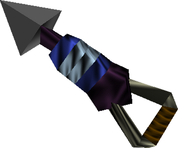

<h1 align="center">
  
   
  <b>Longshot</b>
</h1>

<h4 align="center">The Legend of Zelda: Ocarina of Time (Nintendo Switch 2) running natively on Windows & Linux, with no emulator.</h4>

Longshot is a fork of [Hookshot](https://github.com/NotRexed/Hookshot), the static recompilation of Ocarina of Time for
Switch 2. It is based on Hookshot's main branch after v2.0.6, adds AMD FSR 4, and differs in one way: **nothing is
merged untested.**

> [!IMPORTANT]
> This repository **does not contain the game, keys or an executable**, and it does not explain how to get them. You
> need your own copy. Everything a build creates comes from your game and stays on your PC. Never share those files.

## How changes get in

1. **Played before merged.** Every change, ours or someone else's, is tested in-game on real hardware first, and the
   test is written down with it.
2. **Picked one at a time.** Fixes from Hookshot and other forks come in with `git cherry-pick -x`, keeping their
   author, and are listed in [PICKS.md](PICKS.md).
3. **Semantic versions.** From 1.0.0: patch releases (1.0.x) are fixes only, minor releases (1.x.0) add features, and
   major releases change saves, settings or the build. Each release's changes are in [CHANGELOG.md](CHANGELOG.md).

## Status

No releases yet; built from source. The main test PC uses an AMD Radeon RX 6700 XT (RDNA2) on Windows 11.

Differences from Hookshot so far:

- **AMD FSR 4**: AMD's temporal upscaler (and its Native AA) in the Graphics tab's **Upscaler** row, from Hookshot PR
  #1008, which Hookshot has not merged yet. Tick **AMD FSR 4** in Longshot Builder; AMD's DLLs are not included (see
  [AMD FSR 4](docs/hookshot-readme.md#build-from-source)).
- **AMD terrain grid fix kept on**: Hyrule Field's ground has no grid lines on AMD. (Hookshot turned this fix off in
  v2.0.6.)
- **BC3 re-encode in runs of up to 8 layers**, as in v2.0.5. (Hookshot made it one layer a run in v2.0.6.)

## Build

The same as Hookshot: see [Build from source](docs/hookshot-readme.md#build-from-source). The builder is
**Longshot Builder** and the game folder's launcher is **Longshot.exe**; both check Longshot's releases for updates. The
files inside the game folder keep Hookshot's names (`bin\hookshot.exe`, `hookshot_options.ini`), so a Hookshot
folder's settings carry over.

Longshot Builder has no download yet: build it from `builder/` (see `.github/workflows/windows-builder.yml`).

## Credits

Longshot is built on Hookshot by **NotRexed** and its contributors, and on the projects Hookshot credits: Eden,
Eglantine, suyu, EvilOOT, Lichii, Orchid, Mesa and others. See [Hookshot's credits](docs/hookshot-readme.md#credits).
Everyone whose fix is picked into Longshot is named in [PICKS.md](PICKS.md).

## License

Free software under the [GNU General Public License, version 3 or later](LICENSE) (GPL-3.0-or-later), like Hookshot.
Third-party parts keep their own notices in their folders.

Longshot is an unofficial fan project, not affiliated with or endorsed by Nintendo. The Legend of Zelda and Ocarina of
Time are trademarks of Nintendo.
